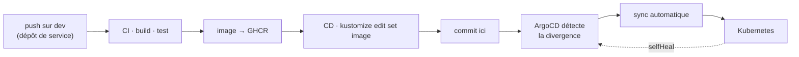

# wely-gitops-infra

Infrastructure déclarative de la plateforme [Wely Calendar](https://github.com/banettetheo) : manifestes Kubernetes organisés en Kustomize, applications ArgoCD, secrets chiffrés.

**Ce dépôt est la source de vérité de l'état du cluster.** Aucun déploiement ne se fait par `kubectl apply` manuel.

---

## Le modèle GitOps



La CD d'un service **ne parle jamais au cluster**. Elle met à jour le tag d'image dans ce dépôt, et ArgoCD — qui le surveille avec `automated.selfHeal: true` et `prune: true` — réconcilie l'état réel.

Deux conséquences :

- **L'état du cluster est lisible dans Git**, pas dans l'historique d'un pipeline. `git log` répond à « qu'est-ce qui tourne, depuis quand, poussé par quoi ».
- **Une modification manuelle du cluster est annulée automatiquement.** `selfHeal` garantit qu'aucune dérive ne survit.

---

## Structure

```
├── argocd/
│   └── applications.yaml         Applications ArgoCD (platform, observability, dev)
├── base/                         manifestes communs à tous les environnements
│   ├── wely-gateway.yaml         ─┐
│   ├── wely-users.yaml            │  services applicatifs
│   ├── wely-social.yaml           │
│   ├── wely-chat.yaml             │
│   ├── wely-media.yaml            │  (interne : octets des photos)
│   ├── wely-events.yaml           │
│   ├── wely-web.yaml             ─┘
│   ├── wely-auth.yaml            Keycloak
│   ├── wely-postgres-auth.yaml   ─┐
│   ├── wely-postgres-users.yaml   │  bases de données
│   ├── wely-mongodb.yaml          │  (StatefulSets)
│   ├── wely-neo4j.yaml           ─┘
│   ├── wely-redis.yaml           compteurs de quota de la gateway (sans persistance)
│   ├── cloudflared.yaml          tunnel Cloudflare (exposition publique)
│   └── wely-tailscale.yaml       opérateur Tailscale (accès administrateur)
├── observability/
│   ├── prometheus/               Prometheus, opt-in per overlay (dev), not exposed
│   ├── node-exporter/            node metrics of the Pi (CPU, RAM, disks, temperature)
│   └── grafana/                  dashboards + Discord alerts, provisioned from Git (port-forward)
└── overlays/
    └── dev/                      cluster Raspberry Pi — SealedSecrets, images par SHA
```

### Composition Kustomize

```
                      ┌──────────────────┐
                      │       base/      │   déploiements, services,
                      │                  │   StatefulSets, config commune
                      └────────┬─────────┘
                               │
                               ▼
                        ┌─────────────┐
                        │    dev/     │
                        │             │
                        │ namePrefix  │
                        │   dev-      │
                        │ SealedSecr. │
                        │ images @SHA │
                        └─────────────┘
```

---

## Gestion des secrets

Les secrets de l'environnement `dev` sont chiffrés avec **Sealed Secrets** et committés sans risque : seul le contrôleur installé dans le cluster détient la clé de déchiffrement.

```bash
kubeseal --format yaml < secret.yaml > overlays/dev/wely-sealed-secrets-dev.yaml
```

C'est ce qui rend le modèle GitOps praticable : sans cela, il faudrait une source de secrets hors Git et l'état du cluster ne serait plus entièrement décrit par le dépôt.

---

## Exposition réseau

| Composant | Rôle |
|---|---|
| **Cloudflare Tunnel** | Expose la gateway et Keycloak sur Internet sans ouvrir de port entrant ni IP publique |
| **Tailscale Operator** | Accès administrateur au cluster (kubectl, bases) via réseau privé |

Le cluster tourne sur un ensemble de Raspberry Pi derrière une connexion résidentielle : le tunnel sortant est ce qui rend l'exposition possible sans IP fixe.

---

## Stockage des photos

Les photos (avatars, photos des conversations, couvertures et tickets d'événement) sont sur **Cloudflare R2** depuis le 2026-11-15, buckets `wely-dev-*`. `wely-media` normalise et signe, le navigateur va chercher les octets chez R2 avec l'URL signée. Garage, son job d'initialisation et sa sauvegarde nocturne ont été supprimés avec le disque qu'ils protégeaient : R2 réplique ses objets lui-même, il n'y a plus de volume à sauvegarder.

> **Restauration après des suppressions de compte.** R2 ne versionne pas les buckets par défaut. Si une restauration devient nécessaire, elle remonte des médias que les suppressions de compte avaient retirés et que plus rien ne référence :
>
> - avatars : dans Neon, `UPDATE account_deletion SET media_deleted_at = NULL, next_attempt_at = now() WHERE requested_at > now() - interval '8 days';` et l'`AccountDeletionWorker` de wely-users purge à nouveau `avatars/<businessId>/` pour ces comptes ;
> - médias d'événement dans `wely-dev-event-media` : les tickets que wely-events a retirés des dépenses des comptes supprimés, plus la couverture et les tickets des événements effacés. Leurs clés ont déjà disparu d'`events_db`, donc rien ne les resupprime. Lister `events/` (rclone, comme dans `demo/demo-reset.yaml`) et supprimer tout objet antérieur à la restauration qu'aucun `events.image` ni `expenses.receiptKey` ne référence. Aucun outil ne fait ce balayage.

## Account deletion

wely-users deletes the account (tombstone, Keycloak user, avatars); wely-social, wely-chat, wely-events and wely-notifications erase their copies when they consume `USER_DELETED`, and again in a daily reconciliation pass. This repository provides:

| Setting | Where | Effect |
|---|---|---|
| `ACCOUNT_DELETION_ENABLED` | wely-users: `"true"` in the dev patch | Turns account deletion on. wely-users defaults to off: `DELETE /profile` and `GET /profile/deletion` both answer 403 `USR-BUS-014`. prod leaves it off. |
| `ACCOUNT_DELETION_PROTECTED_USER_IDS` | dev: ConfigMap `wely-account-deletion`, generated in `overlays/dev/kustomization.yaml`, read by wely-users, wely-social and wely-events | The ten demo accounts of `demo/demo-reset.yaml`. wely-users refuses their deletion (403 `USR-BUS-011`). wely-events never erases them nor hands them a deleted organizer's events. wely-social never counts them as or promotes them to community admin, on any leave: an admin who leaves a community where only demo accounts remain gets `COMMUNITY_LAST_MEMBER`, or deletes it with `deleteIfLast`. Unset in prod. |
| `DELETED_USERS_READER_SECRET` | wely-users and the four consumers, from the optional Secret `dev-wely-deleted-users` | wely-users checks it on `GET /user-service/internal/deleted-users`; the consumers send it when their reconciliation pages through that list. Unset, wely-users refuses every call (401) and a consumer's pass fails without calling it. dev: not sealed yet. |
| `USERS_API_URL` | wely-social, wely-chat, wely-events and wely-notifications: `http://wely-users-service:8082` in the base, the `dev-` Service name in the overlay's patch | Where the reconciliation reads the deleted-users list: straight on the wely-users Service, since the gateway answers 404 for `/api/v1/*/internal/**`. |

The demo accounts must stay protected: their credentials are public, the nightly reset neither recreates their Keycloak user nor survives a tombstone (`account_deletion` references the row), and the consumers keep a permanent deleted-user marker. A deleted demo account would be gone for good. Keep the ConfigMap and `DEMO_USER_IDS` in step; a change to the ConfigMap restarts its three readers.

**Rollout order.** The protected list must be live before a wely-users image that serves `DELETE /profile` reaches dev, because a push to wely-users' `dev` branch commits its image tag straight to `main` here:

1. Merge this change to `main` and let ArgoCD sync it.
2. Check the `dev-wely-users` pod in ArgoCD: its environment has `ACCOUNT_DELETION_PROTECTED_USER_IDS` and `ACCOUNT_DELETION_ENABLED`, and its log reads `Account deletion: 10 protected account(s), enabled`.
3. Only then merge wely-users, then wely-web, into `dev`.

`ACCOUNT_DELETION_ENABLED` makes the order a safeguard rather than a requirement: a wely-users image that arrives first keeps deletion off instead of unguarded.

`realm/realm-settings-job.yaml` also adds `wely://oauth-callback` to wely-client's redirect URIs (wely-ios opens Keycloak's sign-up page and comes back on that scheme), keeping the URIs already set, and checks, at every sync, that wely-client's access tokens carry `auth_time` (the `basic` default scope and its `AUTH_TIME` note mapper, no lightweight tokens). Without it, `DELETE /profile` always answers 403 `USR-BUS-010`; the Job then fails and ArgoCD shows it.

**Reconciliation.** Erasure does not rely on Kafka delivering every `USER_DELETED`. Each consumer runs a `DeletedUsersReconciliationLoop`: 1 minute after start, then every 24 h (1 h after a pass that failed), it pages through wely-users' tombstones and erases every account it has not erased yet, plus every account deleted in the last 48 h. `ACCOUNT_ERASURE_RECONCILIATION_ENABLED=false` turns the loop off in a service; this repository leaves it at its default, on. Until the dev secret is sealed, every pass fails without calling wely-users and is retried an hour later.

NetworkPolicy: `allow-users` admits the four consumers on port 8082. A policy filters the pod (container) port, and for wely-users the Service maps 8082 to the same 8082. The other calls already had their rules: wely-users to Keycloak's Admin API (user logout and delete, `allow-auth`, port 8080) and to wely-media's prefix purge (`allow-media`, port 8085), on ports where container and Service agree. `allow-kafka` already admits the four `USER_DELETED` consumers. No egress policy exists, so nothing restricts the callers' side.

To seal the reader secret for dev, use two commits:

1. Run the command below, add `wely-sealed-deleted-users-dev.yaml` to the dev `resources` (namePrefix makes it `dev-wely-deleted-users`), commit, and let ArgoCD sync.
2. Check, read-only, that the controller has unsealed it: `kubectl get secret dev-wely-deleted-users -n wely-dev` lists it with `DATA 1`.
3. In a second commit, bump `wely.dev/deleted-users-key` in `overlays/dev/kustomization.yaml` (`"0"` to `"1"`). That value sits in one patch applied to wely-users, wely-social, wely-chat, wely-events and wely-notifications, so the single bump restarts all five readers.

```bash
kubectl create secret generic wely-deleted-users -n wely-dev \
  --from-literal=deleted-users-reader-secret="$(openssl rand -hex 32)" \
  --dry-run=client -o yaml \
  | kubeseal --scope cluster-wide --format yaml > overlays/dev/wely-sealed-deleted-users-dev.yaml
```

The Secret reference is optional and read once, when the container starts. A Secret that appears later leaves the pod templates unchanged, so neither Kubernetes nor ArgoCD restarts the pods: without the bump, wely-users keeps refusing the listing (401) and the consumers' passes keep failing until some unrelated rollout.

The bump needs its own commit. In the commit that adds the SealedSecret, ArgoCD applies it after the Deployments (custom resources come last in a wave), and the controller unseals it a few seconds later. The restarted pods can start before the Secret exists and keep an empty value until their next restart. `wely.dev/calls-keys` hit exactly this (commit `794a733`). Nothing in ArgoCD shows it: the pods are healthy, wely-users answers 401, and each consumer's pass fails and is retried an hour later.

A rotation takes the same two commits. Note the Secret's `resourceVersion` (`kubectl get secret dev-wely-deleted-users -n wely-dev -o jsonpath='{.metadata.resourceVersion}'`), re-run the command and commit, wait until the `resourceVersion` changes, then bump the annotation again. Until the bump, all five readers keep the old value and still agree; during the restart, a reader still on the old value gets 401 and its pass is retried an hour later.

## Kafka retention

Le broker est **Confluent Cloud** depuis le 2026-11-15 (cluster `wely-dev-kafka`, SASL_SSL ; bootstrap et clés dans `wely-sealed-cloud-dev.yaml`). Le broker en cluster, son UI et le Job qui créait les topics ont été supprimés avec l'overlay `local`, seul consommateur restant. **Les topics et leur rétention se règlent donc dans la console Confluent**, plus dans Git — les valeurs ci-dessous sont celles que le Job appliquait et restent la référence à reproduire.

| Politique | Topics | `retention.ms` | `segment.ms` | Durée de vie max d'un enregistrement |
|---|---|---|---|---|
| `live` | `DEV_MESSAGE_BROADCAST`, `DEV_CALL_EVENTS` | 3600000 (1 h) | 900000 (15 min) | environ 1 h 20 |
| `personal` | `USER_CREATED`, `USER_MODIFIED`, `FRIENDSHIP_CHANGED`, `USER_BIRTHDAY`, `BIRTHDAY_NOTICES`, `FRIENDSHIP_NOTICES` | 259200000 (3 j) | 86400000 (1 j) | environ 4 j |
| `erasure` | `USER_DELETED` | 604800000 (7 j) | 86400000 (1 j) | environ 8 j |
| `state` | `FRIENDSHIP_STATE` | défaut du broker | défaut du broker | — |
| aucune | `EVENT_GROUP_CHANGED`, `EVENT_DATE_FIXED` | défaut du broker (7 j) | défaut du broker (7 j) | environ 14 j |

Kafka ne supprime que les segments fermés : un enregistrement peut survivre à `retention.ms` de `segment.ms`, plus les 5 minutes du cycle de rétention.

**Pourquoi c'est sans danger pour la suppression de compte.** L'effacement ne dépend jamais de la rétention Kafka. `USER_DELETED` ne fait que l'accélérer : la réconciliation quotidienne des consommateurs parcourt les pierres tombales de wely-users, qui sont permanentes — un consommateur qui rate un enregistrement (arrêt plus long que la rétention, ou nouveau groupe) efface quand même le compte à sa passe suivante.

**Ce que coûtent les fenêtres courtes.**

- `live` : wely-chat lit ces topics depuis le dernier offset, avec un groupe par pod — aucun backlog nécessaire. wely-notifications garde un seul groupe : arrêté plus d'environ 1 h, il perd les notifications de messages et d'appels de la panne. Les messages eux-mêmes restent dans wely-chat.
- `personal` : un wely-social arrêté plus d'environ 3 j perd les créations et renommages publiés entre-temps, et rien ne les réconcilie (seules les suppressions le sont). Un wely-notifications arrêté aussi longtemps perd les notifications de demandes d'ami.

## Commandes utiles

```bash
kubectl kustomize overlays/dev          # rendu des manifestes sans appliquer

argocd app list
argocd app get wely-dev
argocd app diff wely-dev                # écart entre Git et le cluster
```

> **Ne jamais faire de `kubectl apply` sur `dev` ou `prod`** : ArgoCD annulerait la modification au prochain cycle de réconciliation. Le chemin normal est un commit sur ce dépôt.

---

## Limites connues

- **Keycloak n'a pas de probes.** Ses endpoints de santé ont changé de port en version 25 (`:9000/health/ready` au lieu de `:8080/health/ready`), et l'image est construite sur `quay.io/keycloak/keycloak:latest` : impossible de savoir lequel s'applique avant d'épingler le tag. Une probe sur le mauvais port mettrait l'IdP en `CrashLoopBackOff` et couperait toute la plateforme. **Prérequis : épingler l'image.**
- **Le frontend n'a pas `readOnlyRootFilesystem`.** `entrypoint.sh` réécrit `index.html` au démarrage pour injecter `KEYCLOAK_URL`, et nginx écrit son cache. Servir cette configuration depuis un ConfigMap au lieu de muter l'artefact permettrait de verrouiller ce conteneur aussi.
- **Pas de `NetworkPolicy`** : tout pod peut joindre tout autre pod, y compris les bases.
- **Il n'y a pas d'environnement de production.** `overlays/prod` a été supprimé le 2026-11-15 : images en `latest`, aucun Secret, déployé par personne. Une prod se construira comme une copie de `overlays/dev` — mêmes images, mêmes services managés, realm et préfixe de topic différents.
- **Les patches de l'overlay `dev` sont positionnels** (`/env/0/value`, `/env/1/value`…). Insérer une variable d'environnement dans la base décale tous les indices et réaffecte silencieusement les mauvaises valeurs. À remplacer par des patches stratégiques nommés.
- **La base référence un Secret préfixé `dev-`**, ce qui inverse la logique Kustomize : la base ne devrait rien savoir des overlays.
- **Secrets en clair dans `base/wely-secrets-dev.yaml`** — à remplacer par un SealedSecret ou un fichier d'exemple.
- **Pas de HPA ni de PodDisruptionBudget.**
