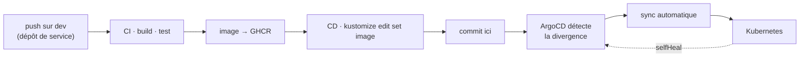

# wely-gitops-infra

Infrastructure déclarative de la plateforme [Wely Calendar](https://github.com/banettetheo) : manifestes Kubernetes organisés en Kustomize, applications ArgoCD, secrets chiffrés.

**Ce dépôt est la source de vérité de l'état du cluster.** Aucun déploiement ne se fait par `kubectl apply` manuel.

---

## Le modèle GitOps



La CD d'un service **ne parle jamais au cluster**. Elle met à jour le tag d'image dans ce dépôt, et ArgoCD — qui le surveille avec `automated.selfHeal: true` et `prune: true` — réconcilie l'état réel.

Deux conséquences :

- **L'état du cluster est lisible dans Git**, pas dans l'historique d'un pipeline. `git log` répond à « qu'est-ce qui tourne, depuis quand, poussé par quoi ».
- **Une modification manuelle du cluster est annulée automatiquement.** `selfHeal` garantit qu'aucune dérive ne survit.

---

## Structure

```
├── argocd/
│   └── applications.yaml         Applications ArgoCD (dev, prod)
├── base/                         manifestes communs à tous les environnements
│   ├── wely-gateway.yaml         ─┐
│   ├── wely-users.yaml            │  services applicatifs
│   ├── wely-social.yaml           │
│   ├── wely-chat.yaml             │
│   ├── wely-media.yaml            │  (interne : octets des photos)
│   ├── wely-events.yaml           │
│   ├── wely-web.yaml             ─┘
│   ├── wely-auth.yaml            Keycloak
│   ├── wely-postgres-auth.yaml   ─┐
│   ├── wely-postgres-users.yaml   │  bases de données
│   ├── wely-mongodb.yaml          │  (StatefulSets)
│   ├── wely-neo4j.yaml           ─┘
│   ├── wely-kafka.yaml           broker + UI
│   ├── wely-redis.yaml           compteurs de quota de la gateway (sans persistance)
│   ├── cloudflared.yaml          tunnel Cloudflare (exposition publique)
│   └── wely-tailscale.yaml       opérateur Tailscale (accès administrateur)
└── overlays/
    ├── local/                    Kubernetes local — secrets en clair, images locales
    ├── dev/                      cluster Raspberry Pi — SealedSecrets, images par SHA
    └── prod/                     namespace séparé, réplicas augmentés
```

### Composition Kustomize

```
                      ┌──────────────────┐
                      │       base/      │   déploiements, services,
                      │                  │   StatefulSets, config commune
                      └────────┬─────────┘
                ┌──────────────┼──────────────┐
                ▼              ▼              ▼
        ┌─────────────┐ ┌─────────────┐ ┌─────────────┐
        │   local/    │ │    dev/     │ │   prod/     │
        │             │ │             │ │             │
        │ ns: wely-   │ │ namePrefix  │ │ ns: wely-   │
        │     local   │ │   dev-      │ │     prod    │
        │ secrets     │ │ SealedSecr. │ │ replicas: 2 │
        │  en clair   │ │ images @SHA │ │             │
        └─────────────┘ └─────────────┘ └─────────────┘
```

---

## Gestion des secrets

Les secrets de l'environnement `dev` sont chiffrés avec **Sealed Secrets** et committés sans risque : seul le contrôleur installé dans le cluster détient la clé de déchiffrement.

```bash
kubeseal --format yaml < secret.yaml > overlays/dev/wely-sealed-secrets-dev.yaml
```

C'est ce qui rend le modèle GitOps praticable : sans cela, il faudrait une source de secrets hors Git et l'état du cluster ne serait plus entièrement décrit par le dépôt.

L'overlay `local` utilise des secrets en clair, délibérément — il ne cible qu'un cluster de développement sur poste.

---

## Exposition réseau

| Composant | Rôle |
|---|---|
| **Cloudflare Tunnel** | Expose la gateway et Keycloak sur Internet sans ouvrir de port entrant ni IP publique |
| **Tailscale Operator** | Accès administrateur au cluster (kubectl, bases) via réseau privé |

Le cluster tourne sur un ensemble de Raspberry Pi derrière une connexion résidentielle : le tunnel sortant est ce qui rend l'exposition possible sans IP fixe.

---

## Sauvegardes de Garage

Les photos (avatars, photos des conversations, couvertures et tickets d'événement) vivent dans Garage, sur le disque du Pi. `base/wely-garage-backup.yaml` les sauvegarde chaque nuit à 03:00 UTC, sans clé S3 ni interruption :

1. un conteneur demande à Garage un **snapshot cohérent de ses métadonnées** (`CreateMetadataSnapshot`, API d'administration) ;
2. un second monte le volume de Garage **en lecture seule** et recopie dans `wely-garage-backup` (10 Gio) le snapshot, la clé du nœud et le layout, puis les **blocs** : ils sont adressés par leur contenu et jamais réécrits, donc chaque jour reprend ceux de la veille par **lien dur** et ne copie que les nouveaux ; un bloc n'est jamais écrasé (ce qui modifierait aussi les jours précédents à travers le lien) ;
3. 7 jours sont gardés.

Restaurer : passer le StatefulSet `dev-wely-garage` à 0 réplica, recopier `<jour>/meta/*` dans `meta/` (le snapshot devient `db.sqlite`) et `<jour>/data/` dans `data/` du volume `garage-data-dev-wely-garage-0`, repasser à 1.

> **Même disque.** Ce volume protège d'une suppression malheureuse, d'un bug ou d'une base corrompue, pas de la perte du disque du Pi. Une copie hors du Pi de `wely-garage-backup` reste à décider (machine de la maison via Tailscale, ou stockage externe).

> **Restore after account deletions.** Restoring day J brings back the media that account deletions removed after J, which nothing references any more:
>
> - avatars: in `dev-wely-postgres-users`, run `UPDATE account_deletion SET media_deleted_at = NULL, next_attempt_at = now() WHERE requested_at > now() - interval '8 days';` and wely-users' `AccountDeletionWorker` purges `avatars/<businessId>/` again for those accounts;
> - event media in `wely-event-media`: the receipts wely-events dropped from the deleted users' expenses, and the cover and receipts of the events the erasure deleted. Their keys are already gone from `events_db`, so nothing deletes them again. List `events/` (rclone, as in `demo/demo-reset.yaml`) and delete every object last modified before the restore that no `events.image` and no `expenses.receiptKey` references. No tool does this sweep yet: until one exists, skipping it leaves a copy of the deleted users' receipts in Garage.

## Account deletion

wely-users deletes the account (tombstone, Keycloak user, avatars); wely-social, wely-chat, wely-events and wely-notifications erase their copies when they consume `USER_DELETED`, and again in a daily reconciliation pass. This repository provides:

| Setting | Where | Effect |
|---|---|---|
| `ACCOUNT_DELETION_ENABLED` | wely-users: `"true"` in the dev and local patches | Turns account deletion on. wely-users defaults to off: `DELETE /profile` and `GET /profile/deletion` both answer 403 `USR-BUS-014`. prod leaves it off. |
| `ACCOUNT_DELETION_PROTECTED_USER_IDS` | dev: ConfigMap `wely-account-deletion`, generated in `overlays/dev/kustomization.yaml`, read by wely-users, wely-social and wely-events | The ten demo accounts of `demo/demo-reset.yaml`. wely-users refuses their deletion (403 `USR-BUS-011`). wely-events never erases them nor hands them a deleted organizer's events. wely-social never counts them as or promotes them to community admin, on any leave: an admin who leaves a community where only demo accounts remain gets `COMMUNITY_LAST_MEMBER`, or deletes it with `deleteIfLast`. Unset in local and prod. |
| `DELETED_USERS_READER_SECRET` | wely-users and the four consumers, from the optional Secret `dev-wely-deleted-users` | wely-users checks it on `GET /user-service/internal/deleted-users`; the consumers send it when their reconciliation pages through that list. Unset, wely-users refuses every call (401) and a consumer's pass fails without calling it. local: `overlays/local/wely-deleted-users-local.yaml` in plaintext. dev: not sealed yet. |
| `USERS_API_URL` | wely-social, wely-chat, wely-events and wely-notifications: `http://wely-users-service:8082` in the base, the `dev-` or `local-` Service name in each overlay's patch | Where the reconciliation reads the deleted-users list: straight on the wely-users Service, since the gateway answers 404 for `/api/v1/*/internal/**`. |

The demo accounts must stay protected: their credentials are public, the nightly reset neither recreates their Keycloak user nor survives a tombstone (`account_deletion` references the row), and the consumers keep a permanent deleted-user marker. A deleted demo account would be gone for good. Keep the ConfigMap and `DEMO_USER_IDS` in step; a change to the ConfigMap restarts its three readers.

**Rollout order.** The protected list must be live before a wely-users image that serves `DELETE /profile` reaches dev, because a push to wely-users' `dev` branch commits its image tag straight to `main` here:

1. Merge this change to `main` and let ArgoCD sync it.
2. Check the `dev-wely-users` pod in ArgoCD: its environment has `ACCOUNT_DELETION_PROTECTED_USER_IDS` and `ACCOUNT_DELETION_ENABLED`, and its log reads `Account deletion: 10 protected account(s), enabled`.
3. Only then merge wely-users, then wely-web, into `dev`.

`ACCOUNT_DELETION_ENABLED` makes the order a safeguard rather than a requirement: a wely-users image that arrives first keeps deletion off instead of unguarded.

`realm/realm-settings-job.yaml` also adds `wely://oauth-callback` to wely-client's redirect URIs (wely-ios opens Keycloak's sign-up page and comes back on that scheme), keeping the URIs already set, and checks, at every sync, that wely-client's access tokens carry `auth_time` (the `basic` default scope and its `AUTH_TIME` note mapper, no lightweight tokens). Without it, `DELETE /profile` always answers 403 `USR-BUS-010`; the Job then fails and ArgoCD shows it.

**Reconciliation.** Erasure does not rely on Kafka delivering every `USER_DELETED`. Each consumer runs a `DeletedUsersReconciliationLoop`: 1 minute after start, then every 24 h (1 h after a pass that failed), it pages through wely-users' tombstones and erases every account it has not erased yet, plus every account deleted in the last 48 h. `ACCOUNT_ERASURE_RECONCILIATION_ENABLED=false` turns the loop off in a service; this repository leaves it at its default, on. Until the dev secret is sealed, every pass fails without calling wely-users and is retried an hour later.

NetworkPolicy: `allow-users` admits the four consumers on port 8082. A policy filters the pod (container) port, and for wely-users the Service maps 8082 to the same 8082. The other calls already had their rules: wely-users to Keycloak's Admin API (user logout and delete, `allow-auth`, port 8080) and to wely-media's prefix purge (`allow-media`, port 8085), on ports where container and Service agree. `allow-kafka` already admits the four `USER_DELETED` consumers. No egress policy exists, so nothing restricts the callers' side.

To seal the reader secret for dev, use two commits:

1. Run the command below, add `wely-sealed-deleted-users-dev.yaml` to the dev `resources` (namePrefix makes it `dev-wely-deleted-users`), commit, and let ArgoCD sync.
2. Check, read-only, that the controller has unsealed it: `kubectl get secret dev-wely-deleted-users -n wely-dev` lists it with `DATA 1`.
3. In a second commit, bump `wely.dev/deleted-users-key` in `overlays/dev/kustomization.yaml` (`"0"` to `"1"`). That value sits in one patch applied to wely-users, wely-social, wely-chat, wely-events and wely-notifications, so the single bump restarts all five readers.

```bash
kubectl create secret generic wely-deleted-users -n wely-dev \
  --from-literal=deleted-users-reader-secret="$(openssl rand -hex 32)" \
  --dry-run=client -o yaml \
  | kubeseal --scope cluster-wide --format yaml > overlays/dev/wely-sealed-deleted-users-dev.yaml
```

The Secret reference is optional and read once, when the container starts. A Secret that appears later leaves the pod templates unchanged, so neither Kubernetes nor ArgoCD restarts the pods: without the bump, wely-users keeps refusing the listing (401) and the consumers' passes keep failing until some unrelated rollout.

The bump needs its own commit. In the commit that adds the SealedSecret, ArgoCD applies it after the Deployments (custom resources come last in a wave), and the controller unseals it a few seconds later. The restarted pods can start before the Secret exists and keep an empty value until their next restart. `wely.dev/calls-keys` hit exactly this (commit `794a733`). Nothing in ArgoCD shows it: the pods are healthy, wely-users answers 401, and each consumer's pass fails and is retried an hour later.

A rotation takes the same two commits. Note the Secret's `resourceVersion` (`kubectl get secret dev-wely-deleted-users -n wely-dev -o jsonpath='{.metadata.resourceVersion}'`), re-run the command and commit, wait until the `resourceVersion` changes, then bump the annotation again. Until the bump, all five readers keep the old value and still agree; during the restart, a reader still on the old value gets 401 and its pass is retried an hour later.

## Kafka retention

`base/wely-kafka-topics.yaml` creates the topics and sets their retention. Each `KAFKA_TOPICS` entry is `NAME` or `NAME:policy`, and each overlay lists its own topic names. The Job passes a policy's settings on create (`--config`) and re-applies them at every run with `kafka-configs.sh --alter --add-config`, because `--create --if-not-exists` leaves an existing topic untouched. It is an Argo CD PostSync hook, so every dev sync re-applies the values. An unknown policy, a failed create or a failed alter exits non-zero, and Argo CD shows the failed hook.

| Policy | Topics | `retention.ms` | `segment.ms` | Longest a record stays |
|---|---|---|---|---|
| `live` | `MESSAGE_BROADCAST`, `CALL_EVENTS` (local), `DEV_MESSAGE_BROADCAST`, `DEV_CALL_EVENTS` (dev) | 3600000 (1 h) | 900000 (15 min) | about 1 h 20 |
| `personal` | `USER_CREATED`, `USER_MODIFIED`, `FRIENDSHIP_CHANGED` | 259200000 (3 d) | 86400000 (1 d) | about 4 d |
| `erasure` | `USER_DELETED` | 604800000 (7 d) | 86400000 (1 d) | about 8 d |
| none | `EVENT_GROUP_CHANGED`, `EVENT_DATE_FIXED` | broker default (7 d) | broker default (7 d) | about 14 d |

Kafka only deletes closed segments, so a record can outlive `retention.ms` by up to `segment.ms`, plus the broker's 5-minute retention check. prod gets the same policies on the topics it creates, which are the base's (no broadcast topic).

**Why this is safe for account deletion.** Erasure never depends on Kafka retention. `USER_DELETED` only makes it fast: the consumers' daily reconciliation pages through wely-users' tombstones, which are permanent, so a consumer that misses a record (down longer than the retention, or a new consumer group) still erases the account at its next pass.

**What the shorter windows cost.**

- `live`: wely-chat reads these topics from the latest offset with one group per pod, so it never needs a backlog. wely-notifications keeps one group: down for more than about 1 h, it loses the message and call notifications of the outage. The messages themselves stay in wely-chat.
- `personal`: a wely-social stopped for more than about 3 d loses the creations and renames published meanwhile, and nothing reconciles them (only deletions are). A wely-notifications stopped as long loses friend-request notifications.
- The first sync applies the new values at once: segments older than their policy are deleted within minutes, which cannot be undone.

**Post-sync check (read-only).** The Job ends with `kafka-configs.sh --describe`, so its log lists the dynamic configs of every topic. Each tagged topic shows its policy's `retention.ms` and `segment.ms`; `EVENT_GROUP_CHANGED` and `EVENT_DATE_FIXED` show none.

```bash
kubectl logs -n wely-dev job/dev-wely-kafka-topics --tail=40
# or on demand, inside the broker pod (reads the configs, changes nothing):
kubectl exec -n wely-dev dev-wely-kafka-0 -- /opt/kafka/bin/kafka-configs.sh \
  --bootstrap-server localhost:9092 --describe --entity-type topics
```

To change a value, edit `policy()` in `base/wely-kafka-topics.yaml`. A commit that changes only this Job leaves the dev application Synced, because Argo CD keeps hooks out of the sync status, so no automatic sync runs it: start a sync from Argo CD. Removing a tag does not reset a topic: that takes `kafka-configs.sh --alter --entity-type topics --entity-name <topic> --delete-config retention.ms,segment.ms`. On the local cluster the Job is immutable: see [`README-LOCAL.md`](README-LOCAL.md).

## Environnement local

Toute la plateforme démarre en une commande sur un Kubernetes local.

### Prérequis

Un Kubernetes local — [OrbStack](https://orbstack.dev/) (recommandé), Docker Desktop, Minikube ou k3d — et `kubectl`.

```bash
kubectl apply -k overlays/local --server-side
```

Cela déploie le namespace `wely-local`, les quatre bases, Keycloak, la gateway, le frontend et les quatre microservices, avec leurs secrets locaux préconfigurés.

| Service | URL |
|---|---|
| Frontend | http://localhost |
| Keycloak | http://localhost:8080 *(admin / admin)* |
| Gateway | http://localhost:8081 |

```bash
kubectl delete -k overlays/local        # nettoyage
```

Voir [`README-LOCAL.md`](README-LOCAL.md) pour le détail.

---

## Commandes utiles

```bash
kubectl kustomize overlays/dev          # rendu des manifestes sans appliquer
kubectl kustomize overlays/prod
kubectl apply -k overlays/local --server-side

argocd app list
argocd app get wely-dev
argocd app diff wely-dev                # écart entre Git et le cluster
```

> **Ne jamais faire de `kubectl apply` sur `dev` ou `prod`** : ArgoCD annulerait la modification au prochain cycle de réconciliation. Le chemin normal est un commit sur ce dépôt.

---

## Limites connues

- **Keycloak n'a pas de probes.** Ses endpoints de santé ont changé de port en version 25 (`:9000/health/ready` au lieu de `:8080/health/ready`), et l'image est construite sur `quay.io/keycloak/keycloak:latest` : impossible de savoir lequel s'applique avant d'épingler le tag. Une probe sur le mauvais port mettrait l'IdP en `CrashLoopBackOff` et couperait toute la plateforme. **Prérequis : épingler l'image.**
- **Le frontend n'a pas `readOnlyRootFilesystem`.** `entrypoint.sh` réécrit `index.html` au démarrage pour injecter `KEYCLOAK_URL`, et nginx écrit son cache. Servir cette configuration depuis un ConfigMap au lieu de muter l'artefact permettrait de verrouiller ce conteneur aussi.
- **Pas de `NetworkPolicy`** : tout pod peut joindre tout autre pod, y compris les bases.
- **L'overlay `prod` n'est pas opérationnel** : il utilise `newTag: latest` — non reproductible et indétectable par ArgoCD — et ne définit aucun Secret, alors que la base y fait référence.
- **Les patches de l'overlay `dev` sont positionnels** (`/env/0/value`, `/env/1/value`…). Insérer une variable d'environnement dans la base décale tous les indices et réaffecte silencieusement les mauvaises valeurs. À remplacer par des patches stratégiques nommés.
- **La base référence un Secret préfixé `dev-`**, ce qui inverse la logique Kustomize : la base ne devrait rien savoir des overlays.
- **Secrets en clair dans `base/wely-secrets-dev.yaml`** — à remplacer par un SealedSecret ou un fichier d'exemple.
- **Pas de HPA ni de PodDisruptionBudget.**
